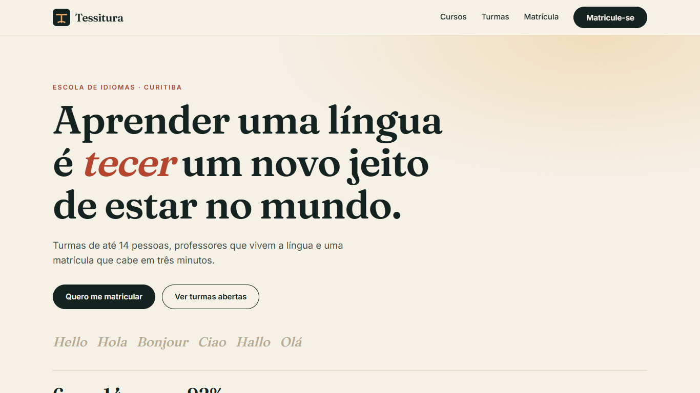
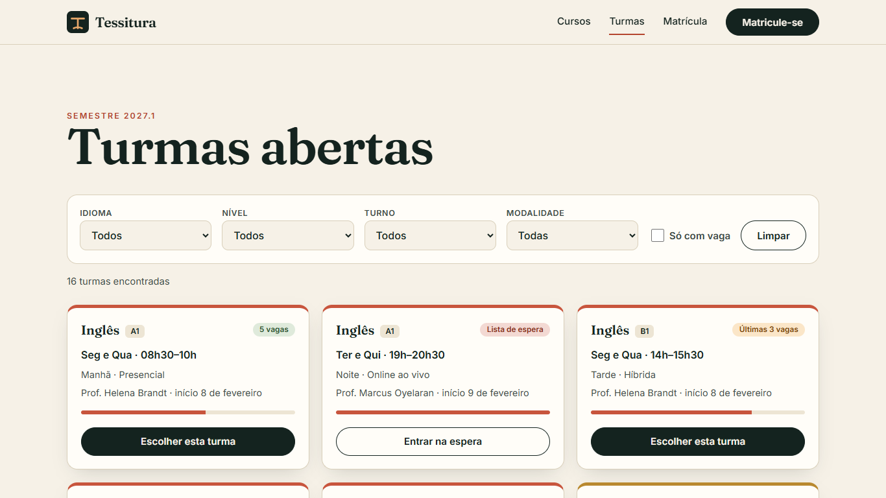
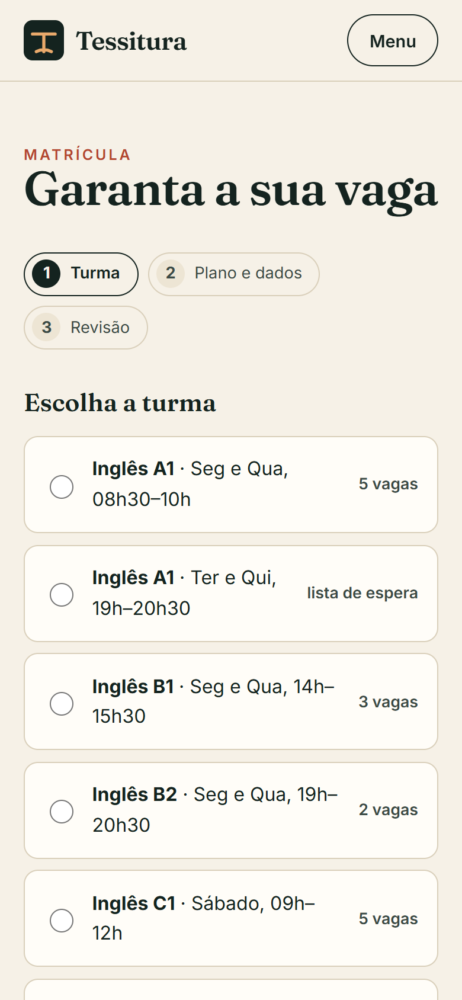

# Tessitura Idiomas

Demo website for a fictional language school in Curitiba, Brazil: course catalogue, class schedule with live seat availability and a three-step enrollment flow.

**Live:** https://alissonlittig.github.io/tessitura-idiomas/





## Features
- Six languages, 16 classes, filters by language, level, shift and mode, "only with seats" toggle
- Seat bar and status (open / last seats / waitlist) per class
- Enrollment wizard: class, plan and student data with validation, review, confirmation
- Responsive down to 390 px, accessible forms, reduced-motion support

## Stack
SvelteKit 3 (Svelte 5 runes) with `adapter-static`, self-hosted fonts (Fraunces, Inter), Vitest. No backend: the enrollment is simulated and nothing is stored or sent.

## Run
```bash
npm ci
npm test
npm run dev
BASE_PATH=/tessitura-idiomas npm run build   # static output in dist/
```

CI (`.github/workflows/pages.yml`) runs tests, builds and deploys to GitHub Pages on every push to `main`.

All names, prices, teachers and contacts are fictional.
